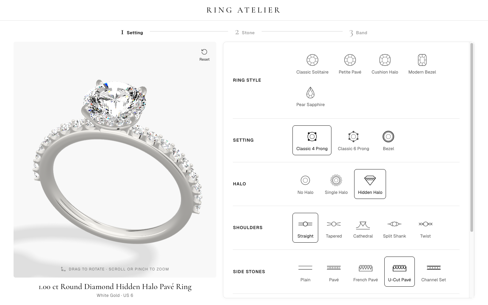

# Ring Atelier: 3D 약혼반지 커스터마이저

[English](README.md) | **한국어**

브라우저에서 약혼반지를 디자인하고 3D로 바로 확인하는 웹 앱입니다. 금속, 스톤, 세팅, 숄더, 사이드 스톤, 밴드를 고른 뒤 링크나 PNG로 공유할 수 있습니다.

**라이브 데모: https://3d-ring-design.vercel.app**



## 기능

- **실시간 3D 미리보기.** 드래그로 회전하고 스크롤이나 핀치로 확대합니다. 옵션을 바꾸면 반지가 즉시 바뀝니다.
- **센터 스톤.** 6가지 모양(라운드, 프린세스, 오벌, 쿠션, 에메랄드, 페어), 5가지 보석, 캐럿을 실제 밀리미터로 환산합니다.
- **세팅.** 클로 프롱 4개 또는 6개, 베젤. 헤일로는 없음, 싱글 헤일로, 히든 헤일로(프롱 안쪽 또는 프롱 위) 중에서 고릅니다.
- **숄더.** 스트레이트, 테이퍼드, 캐시드럴, 스플릿 섕크, 트위스트.
- **사이드 스톤.** 파베, 프렌치 파베, U컷 파베, 채널 세팅, 인셋 U컷 파베(밴드 안으로 파 넣는 형태). 밴드 둘레의 30, 50, 70%를 덮도록 고를 수 있습니다.
- **밴드.** 플래티넘과 옐로·화이트·로즈 골드, 컴포트 핏·플랫·나이프 엣지 단면, US 사이즈, 폭, 두께, 안쪽 각인.
- **프리셋**에서 시작할 수 있고, 완성된 디자인의 요약을 보여 줍니다.
- **공유.** 디자인 전체가 URL(`?d=`)에 담겨서 링크만으로 똑같이 재현됩니다. 현재 화면을 PNG로 내려받을 수도 있습니다.

백엔드도 3D 모델 파일도 없습니다. 반지의 모든 형상은 실제 밀리미터 단위로 코드에서 생성합니다.

## 기술 스택

Next.js 16 (App Router), React 19, three.js와 React Three Fiber·drei, zustand, zod, Tailwind CSS 4와 shadcn/ui, Vitest.

## 시작하기

Node 24가 필요합니다.

```sh
npm install
npm run dev      # http://localhost:3000
npm test         # 단위 테스트
npm run lint
npm run build    # 프로덕션 빌드와 타입 검사
```

## 프로젝트 구조

```
src/
  app/                  페이지와 레이아웃
  components/
    panel/              단계별 옵션 카드 (세팅, 스톤, 밴드)
    ring/               3D 부품: 밴드, 스톤, 프롱, 사이드 스톤, 각인
    viewer/             캔버스, 스튜디오 조명, 카메라, 스크린샷 캡처
  lib/
    ring/               디자인 스키마, 치수, 재질, 표시 이름
    ring/geometry/      순수 지오메트리 함수 (밴드, 보석, 세팅)
    share.ts            디자인 <-> URL 인코딩
  store/                zustand 스토어
```

## 문서

- [plan.ko.md](plan.ko.md): 아키텍처와 범위
- [checklist.ko.md](checklist.ko.md): 단계별 진행 상황
- [context-notes.ko.md](context-notes.ko.md): 결정과 그 이유

## 참고

개인 포트폴리오 프로젝트입니다. "Ring Atelier"는 임시 이름이며 실제 매장이 아니고, 구매 기능은 없습니다.
