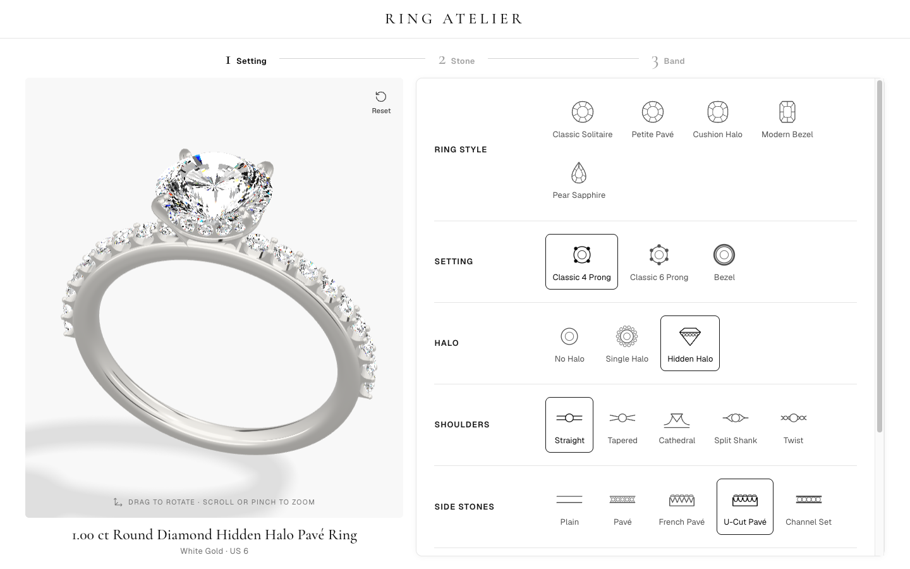

# Ring Atelier: 3D Engagement Ring Customizer

**English** | [한국어](README.ko.md)

Design an engagement ring in the browser and see it update live in 3D. Pick the metal, stone, setting, shoulders, side stones, and band, then share the result as a link or a PNG.

**Live demo: https://3d-ring-design.vercel.app**



## Features

- **Live 3D preview.** Drag to rotate, scroll or pinch to zoom. Every option updates the ring at once.
- **Center stone.** Six shapes (round, princess, oval, cushion, emerald, pear), 5 gemstones, carat weight converted to real millimeters.
- **Setting.** 4 or 6 claw prongs or a bezel; no halo, a single halo, or a hidden halo (inside the prongs or over them).
- **Shoulders.** Straight, tapered, cathedral, split shank, twist.
- **Side stones.** Pavé, French pavé, U-cut pavé, channel set, or inset U-cut pavé (cut into the band), covering 30–70% of the band in steps of 10, set with a slider or by typing the number.
- **Band.** Platinum or yellow, white, or rose gold; comfort-fit, flat, or knife-edge profile; US ring size, width, thickness, and an engraving inside the band.
- **Presets** to start from, and a summary of the finished design.
- **Sharing.** The whole design is stored in the URL (`?d=`), so a link reproduces it exactly. A PNG of the current view can be downloaded.

There is no backend and no 3D model files: all ring geometry is generated in code, in real millimeters.

## Tech stack

Next.js 16 (App Router), React 19, three.js with React Three Fiber and drei, zustand, zod, Tailwind CSS 4 with shadcn/ui, Vitest.

## Getting started

Requires Node 24.

```sh
npm install
npm run dev      # http://localhost:3000
npm test         # unit tests
npm run lint
npm run build    # production build and type check
```

## Project structure

```
src/
  app/                  page and layout
  components/
    panel/              stepped option card (setting, stone, band)
    ring/               3D parts: band, stone, prongs, side stones, engraving
    viewer/             canvas, studio lighting, camera, screenshot capture
  lib/
    ring/               design schema, sizing, materials, labels
    ring/geometry/      pure geometry builders (band, gem, setting)
    share.ts            design <-> URL encoding
  store/                zustand store
```

## Documentation

- [plan.md](plan.md): architecture and scope
- [checklist.md](checklist.md): progress by phase
- [context-notes.md](context-notes.md): decisions and the reasoning behind them

## Notes

A personal portfolio project. "Ring Atelier" is a placeholder name, not a real store, and nothing can be purchased.
